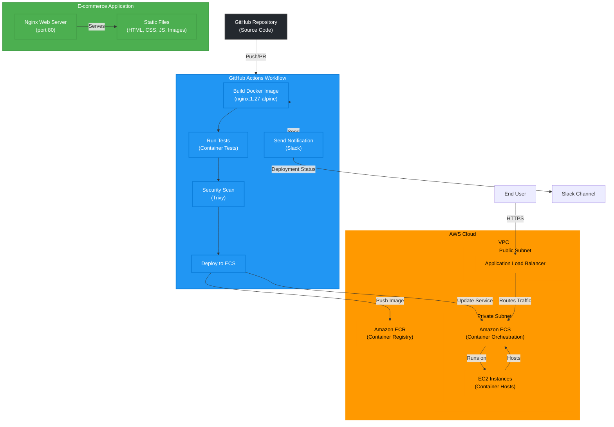

# E-commerce Web Application - ECS Deployment

[](https://github.com/matthewntsiful/ecommerce-app-ecs-deploy/actions/workflows/deploy.yml)
[](https://github.com/aquasecurity/trivy)
[](https://hub.docker.com/_/nginx)
[](https://aws.amazon.com/ecs/)
[](LICENSE)

A containerized e-commerce web application deployed on AWS ECS with automated CI/CD pipeline, security scanning, and Slack notifications.

---

## 🏗️ Architecture



### Architecture Overview

The architecture follows a modern cloud-native approach with the following key components:

1. **Source Control**: GitHub repository hosting the application code and infrastructure as code.
2. **CI/CD Pipeline**: GitHub Actions workflow that automates the build, test, security scan, and deployment processes.
3. **Container Registry**: Amazon ECR stores the Docker images with proper versioning.
4. **Container Orchestration**: Amazon ECS manages the deployment, scaling, and operations of containers.
5. **Compute**: EC2 instances in a private subnet host the ECS containers.
6. **Networking**: VPC with public and private subnets, secured by security groups and network ACLs.
7. **Load Balancing**: Application Load Balancer distributes incoming traffic across ECS tasks.
8. **Monitoring & Logging**: CloudWatch for logs and metrics, with alerts configured.
9. **Security**: IAM roles, security groups, and Trivy scanning for container vulnerabilities.
10. **Notifications**: Slack integration for deployment status updates.

---

## 🚀 Features

- **Containerized Application**: Nginx-based static web application
- **Automated CI/CD**: GitHub Actions pipeline with build, test, and deploy
- **Security Scanning**: Trivy vulnerability scanning with deployment gates
- **AWS ECS Deployment**: Container orchestration on EC2 launch type
- **Slack Notifications**: Real-time deployment status updates
- **Dependency Management**: Automated updates via Dependabot (PRs do not trigger deployment)
- **Infrastructure as Code**: ECS task definitions and configurations

---

## 🛠️ Technology Stack

| Component        | Technology                |
|------------------|--------------------------|
| **Frontend**     | HTML, CSS, JavaScript    |
| **Web Server**   | Nginx 1.27 Alpine        |
| **Container**    | Docker                   |
| **Registry**     | AWS ECR                  |
| **Orchestration**| AWS ECS (EC2 Launch Type)|
| **CI/CD**        | GitHub Actions           |
| **Security**     | Trivy Scanner            |
| **Notifications**| Slack Webhooks           |
| **Monitoring**   | AWS CloudWatch           |

---

## 📋 Prerequisites

- AWS Account with appropriate permissions
- GitHub repository with Actions enabled
- Slack workspace with incoming webhook
- Docker installed locally (for development)

---

## ⚙️ Setup Instructions

### 1. AWS Infrastructure Setup

```bash
# Create ECS Cluster
aws ecs create-cluster --cluster-name ecommerce-cluster

# Create ECR Repository
aws ecr create-repository --repository-name ecommerce-web-app --region eu-north-1

# Create IAM Role for ECS Task Execution
aws iam create-role --role-name ecsTaskExecutionRole --assume-role-policy-document file://trust-policy.json
```

### 2. GitHub Secrets Configuration

Set the following secrets in your GitHub repository:

| Secret Name            | Description             | Example                                             |
|-----------------------|-------------------------|-----------------------------------------------------|
| `AWS_ACCESS_KEY_ID`   | AWS Access Key          | `AKIA...`                                           |
| `AWS_SECRET_ACCESS_KEY`| AWS Secret Key         | `wJalr...`                                          |
| `AWS_REGION`          | AWS Region              | `eu-north-1`                                        |
| `ECR_REPOSITORY_URI`  | ECR Repository URI      | `123456789.dkr.ecr.eu-north-1.amazonaws.com/ecommerce-web-app` |
| `ECS_CLUSTER`         | ECS Cluster Name        | `ecommerce-cluster`                                 |
| `ECS_SERVICE`         | ECS Service Name        | `ecommerce-web-app-service`                         |
| `CONTAINER_NAME`      | Container Name          | `ecommerce-web-app-container`                       |
| `SLACK_WEBHOOK_URL`   | Slack Webhook URL       | `https://hooks.slack.com/...`                       |

### 3. Local Development

```bash
# Clone the repository
git clone https://github.com/matthewntsiful/ecommerce-app-ecs-deploy.git
cd ecommerce-app-ecs-deploy

# Build Docker image locally
docker build -t ecommerce-web-app .

# Run locally
docker run -p 8080:80 ecommerce-web-app
```

---

## 🔄 CI/CD Pipeline

The automated pipeline includes:

1. **Code Checkout**: Retrieves latest code from main branch
2. **AWS Authentication**: Configures AWS credentials
3. **Docker Build**: Creates container image with commit SHA tag
4. **ECR Push**: Uploads image to AWS ECR
5. **Security Scan**: Trivy vulnerability assessment
6. **ECS Deploy**: Updates ECS service with new image
7. **Slack Notification**: Sends deployment status

### Pipeline Triggers

- **Push to main branch**: Automatic deployment
- **Manual trigger**: Via GitHub Actions UI
- **Dependabot PRs**: Excluded from automatic deployment (see workflow conditions)

---

## 🔒 Security Features

### Trivy Vulnerability Scanning
- Scans Docker images for known vulnerabilities
- Blocks deployment on CRITICAL severity issues
- Generates security reports
- Configurable severity thresholds

### Security Configuration Example
```yaml
severity: 'CRITICAL'
exit-code: '1'  # Fails pipeline on vulnerabilities
timeout: '10m'
```

---

## 📊 Resource Configuration

### ECS Task Definition
- **CPU**: 256 CPU units (0.25 vCPU)
- **Memory**: 512 MB
- **Network Mode**: Bridge
- **Launch Type**: EC2

### Container Configuration
- **Base Image**: nginx:1.27-alpine
- **Port**: 80 (HTTP)
- **Memory Reservation**: 256 MB
- **Health Checks**: Built-in nginx health

---

## 🔧 Maintenance

### Automated Updates
- **Dependabot**: Weekly dependency updates (GitHub Actions & Docker)
- **GitHub Actions**: Automatic action version updates
- **Docker Images**: Base image security updates

### Monitoring
- **CloudWatch Logs**: Application and container logs
- **ECS Metrics**: Service health and performance
- **Slack Alerts**: Deployment notifications

---

## 📁 Project Structure

```
├── .github/
│   ├── workflows/
│   │   ├── deploy.yml          # Main CI/CD pipeline
│   │   └── slack.yml           # Slack notification workflow
│   └── dependabot.yml          # Dependency update configuration
├── public/                     # Static web assets
├── src/                        # Application source code
├── Dockerfile                  # Production container definition
├── Dockerfile.test             # Test container definition
├── nginx.conf                  # Nginx configuration
├── task-definition.json        # ECS task definition
└── README.md                   # Project documentation
```

---

## 🚀 Deployment

### Automatic Deployment
Push to main branch triggers automatic deployment:

```bash
git add .
git commit -m "feat: add new feature"
git push origin main
```

### Manual Deployment
Use GitHub Actions UI:
1. Go to Actions tab
2. Select "Build and Push to AWS ECR, then deploy to ECS EC2"
3. Click "Run workflow"

---

## 🐛 Troubleshooting

### Common Issues

| Issue                    | Solution                                      |
|--------------------------|-----------------------------------------------|
| **Insufficient Memory**  | Reduce task memory allocation                 |
| **Security Scan Failures**| Update base image or fix vulnerabilities      |
| **ECS Service Not Found**| Ensure ECS service exists or enable auto-creation |
| **ECR Push Failures**    | Verify AWS credentials and repository permissions |

### Debug Mode
Enable debug logging by setting repository variable:
```
ACTIONS_RUNNER_DEBUG = true
```

---

## 📈 Performance Optimization

- **Multi-stage builds**: Reduce image size
- **Layer caching**: Optimize build times
- **Resource limits**: Right-size container resources
- **Health checks**: Ensure service reliability

---

## 🤝 Contributing

1. Fork the repository
2. Create feature branch (`git checkout -b feature/amazing-feature`)
3. Commit changes (`git commit -m 'Add amazing feature'`)
4. Push to branch (`git push origin feature/amazing-feature`)
5. Open Pull Request

---

## 📄 License

This project is licensed under the MIT License - see the [LICENSE](LICENSE) file for details.

---

## 🙋‍♂️ Support

For support and questions:
- Create an [Issue](https://github.com/matthewntsiful/ecommerce-app-ecs-deploy/issues)
- Check [Discussions](https://github.com/matthewntsiful/ecommerce-app-ecs-deploy/discussions)
- Review [Wiki](https://github.com/matthewntsiful/ecommerce-app-ecs-deploy/wiki)

---

**Powered by Blakk Brother Inc**